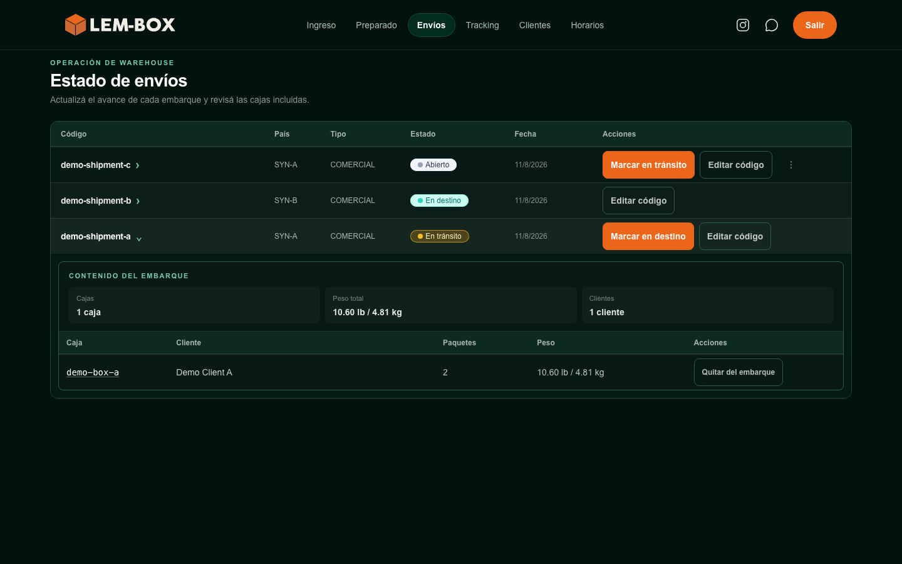

# LEM-BOX Platform — Caso técnico

[English](README.md)

LEM-BOX es una empresa logística con operación entre Estados Unidos, Uruguay y Argentina. Este repositorio es un caso técnico sanitizado sobre cómo las necesidades operativas se tradujeron en decisiones de producto y en una plataforma de software que evoluciona progresivamente, priorizando la continuidad operativa.

> **Límite de producción:** el código fuente, el historial Git, las credenciales, la configuración y los datos productivos permanecen privados. Este compañero, inicializado de forma independiente, contiene documentación pública seleccionada, ejemplos y fixtures ficticios, y evidencia visual fechada. No es el sistema productivo ni una reconstrucción completa.

## Qué contiene este repositorio

- un [caso técnico](docs/case-study.es.md) que conecta operación, producto y desarrollo;
- [arquitectura sanitizada de alto nivel](docs/architecture.es.md) y [flujos seleccionados](docs/selected-workflows.es.md);
- cuatro [ejemplos técnicos](docs/technical-examples.es.md) TypeScript acotados y reimplementados de forma independiente;
- seis archivos de [fixtures ficticios](docs/synthetic-data.es.md) creados expresamente y un validador defensivo;
- nueve capturas seleccionadas de la interfaz web en un [snapshot fechado de agosto de 2026](docs/current-web-snapshot.es.md); y
- nueve registros de decisiones arquitectónicas y doce diagramas Mermaid que documentan el límite público.

Los ejemplos son implementaciones pedagógicas independientes y no tienen dependencias de ejecución. Los fixtures utilizan identificadores evidentes con prefijo `demo-`, geografía ficticia y una ventana temporal fija en 2030. El snapshot visual muestra exclusivamente registros ficticios y no afirma que la interfaz sea final o permanezca siempre actual.



*Vista seleccionada del snapshot web de agosto de 2026. Todos los registros y valores visibles son ficticios.*

## Qué no contiene este repositorio

- código fuente ni historial Git productivo, ni una aplicación equivalente a producción;
- credenciales, identificadores productivos, URLs privadas, configuración de despliegue o scripts administrativos;
- datos de clientes, personal, operación o finanzas;
- integraciones privadas, implementación de pagos, reglas completas de autorización o lógica sensible del negocio;
- implementación, prompts, modelos, proveedores o conversaciones de asistentes internos; ni
- evidencia móvil, de Telegram, bots o mensajería.

El repositorio no demuestra seguridad, disponibilidad, rendimiento, escalabilidad, volumen, resultados comerciales ni comportamiento completo del producto en producción.

## Explorar el caso

| Área | Documento |
|---|---|
| Contexto de producto y operación | [Caso técnico](docs/case-study.es.md) |
| Vista sanitizada del sistema | [Arquitectura](docs/architecture.es.md) |
| Comportamiento seleccionado | [Flujos](docs/selected-workflows.es.md) |
| Ejemplos TypeScript independientes | [Ejemplos técnicos](docs/technical-examples.es.md) |
| Política de fixtures ficticios | [Datos ficticios](docs/synthetic-data.es.md) |
| Evidencia visual fechada | [Snapshot web actual v1](docs/current-web-snapshot.es.md) |
| Límite de publicación | [Alcance público y seguridad](docs/public-scope-and-security.es.md) |
| Reporte seguro de vulnerabilidades | [Política de seguridad](SECURITY.md) |
| Derechos de reutilización | [Licenciamiento](docs/licensing.md) |
| Fases completadas y gates futuros | [Roadmap](docs/roadmap.es.md) |

El material complementario incluye los [recursos y manifest del snapshot](docs/visual-evidence/web-snapshot-v1/), el [paquete de ejemplos](examples/README.md), el [inventario de fixtures](fixtures/README.md), los [registros de decisiones](docs/decisions/), el [aviso](NOTICE.md) y la [política de contribuciones](CONTRIBUTING.md).

## Ejecutar los ejemplos

Se requiere Node.js `>=20.19.0 <21`. Desde `examples/`:

```sh
npm ci
npm run validate
```

El comando ejecuta el typecheck estricto, la suite completa de pruebas y la validación específica de fixtures. Los ejemplos no acceden a la red ni se conectan a bases de datos, servicios cloud, sistemas de autenticación o entornos productivos.

## Contexto del producto

LEM-BOX coordina actividad logística entre tres países. Su ecosistema digital sostiene responsabilidades conectadas que involucran cargas, clientes, pagos, roles y trazabilidad.

La plataforma central reemplaza progresivamente un sistema anterior. Este caso describe la transición en alto nivel: las responsabilidades de producto avanzan mediante una evolución controlada, con la continuidad, la seguridad y los cambios futuros como prioridades explícitas. No publica detalles internos de migración ni afirma resultados medidos.

Rodrigo Opalo fundó LEM-BOX, es responsable de su operación y definió y desarrolló el ecosistema digital que la sostiene. El caso refleja la intersección de tres responsabilidades:

- **Operación:** comprender los flujos y restricciones de una empresa logística activa.
- **Producto:** traducir esas necesidades en alcance y prioridades de migración.
- **Desarrollo:** definir y construir el ecosistema digital que las sostiene.

## Evidencia y actualizaciones futuras

Las Fases 1 a 4A establecieron la documentación, la arquitectura y los flujos sanitizados, los ejemplos y fixtures ficticios, y Current Web Snapshot v1 incluidos aquí. El snapshot de agosto de 2026 conserva valor como evidencia fechada; un cambio material de navegación, identidad visual, flujo, alcance o experiencia según contexto de usuario exige evaluar un refresh selectivo antes de una futura actualización pública.

La evidencia móvil y la Fase 4A2 permanecen como trabajo futuro opcional y separado. Toda incorporación futura requiere revisión individual, sanitización, análisis de secretos, revisión de datos personales y aprobación independiente de publicación.

## Licenciamiento y contribuciones

No se concede una licencia general de reutilización. El uso de las funciones de visualización y fork de GitHub se rige por los [Términos del Servicio de GitHub](https://docs.github.com/en/site-policy/github-terms/github-terms-of-service#5-license-grant-to-other-users). Consultá [Licenciamiento](docs/licensing.md) para conocer el alcance y las limitaciones del repositorio.

Este repositorio se mantiene como un caso técnico de solo lectura. No se aceptan contribuciones externas, solicitudes de funcionalidades ni Pull Requests. Los problemas de seguridad deben seguir [SECURITY.md](SECURITY.md) y nunca publicarse en un issue.
