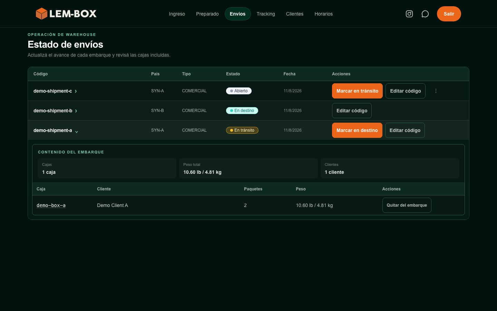

# LEM-BOX Platform — Technical Case Study

[Español](README.es.md)

LEM-BOX is a logistics business operating between the United States, Uruguay, and Argentina. This repository is a sanitized technical case study of how operational needs informed product decisions and a progressively evolving software platform, while prioritizing operational continuity.

> **Production boundary:** production source code, Git history, credentials, configuration, and data remain private. This independently initialized companion contains selected public documentation, synthetic examples and fixtures, and dated visual evidence. It is not the production system or a complete reconstruction.

## What this repository contains

- a [case study](docs/case-study.md) connecting operations, product, and development;
- [sanitized high-level architecture](docs/architecture.md) and [selected workflows](docs/selected-workflows.md);
- four focused, independently reimplemented TypeScript [technical examples](docs/technical-examples.md);
- six purpose-built [synthetic fixture files](docs/synthetic-data.md) and a defensive validator;
- nine selected web-interface captures in an explicitly dated [August 2026 snapshot](docs/current-web-snapshot.md); and
- nine architecture decision records and twelve Mermaid diagrams documenting the public boundary.

The examples are independent teaching implementations with no runtime dependencies. The fixtures use conspicuous `demo-` identifiers, fictional geography, and a fixed 2030 time window. The visual snapshot uses synthetic-only display records and is not a final- or permanently-current-interface claim.



*Selected August 2026 web snapshot. All displayed records and values are synthetic.*

## What this repository does not contain

- production source code, production Git history, or a production-equivalent application;
- credentials, production identifiers, private URLs, deployment configuration, or administrative scripts;
- customer, employee, operational, or financial data;
- private integrations, payment implementation, complete authorization rules, or business-sensitive logic;
- internal-assistant implementation, prompts, models, providers, or conversations; or
- mobile, Telegram, bot, or messaging evidence.

The repository does not demonstrate production security, availability, performance, scalability, volume, commercial results, or complete product behavior.

## Explore the case

| Area | Document |
|---|---|
| Product and operational context | [Case Study](docs/case-study.md) |
| Sanitized system view | [Architecture](docs/architecture.md) |
| Selected behavior | [Workflows](docs/selected-workflows.md) |
| Independent TypeScript examples | [Technical Examples](docs/technical-examples.md) |
| Fictional fixture policy | [Synthetic Data](docs/synthetic-data.md) |
| Dated visual evidence | [Current Web Snapshot v1](docs/current-web-snapshot.md) |
| Publication boundary | [Public Scope and Security](docs/public-scope-and-security.md) |
| Safe vulnerability reporting | [Security Policy](SECURITY.md) |
| Reuse rights | [Licensing](docs/licensing.md) |
| Completed phases and future gates | [Roadmap](docs/roadmap.md) |

Supporting material includes the [snapshot assets and manifest](docs/visual-evidence/web-snapshot-v1/), [examples package](examples/README.md), [fixture inventory](fixtures/README.md), [decision records](docs/decisions/), [notice](NOTICE.md), and [contribution policy](CONTRIBUTING.md).

## Run the examples

Node.js `>=20.19.0 <21` is required. From `examples/`:

```sh
npm ci
npm run validate
```

The validation command runs strict TypeScript checking, the complete test suite, and fixture-specific validation. The examples make no network request and connect to no database, cloud service, authentication system, or production environment.

## Product context

LEM-BOX coordinates logistics activity across three countries. Its digital ecosystem supports connected responsibilities involving shipments, customers, payments, roles, and traceability.

The central platform progressively replaces a legacy system. This case describes that transition at a high level: product responsibilities move through controlled evolution while continuity, security, and future change remain explicit priorities. It does not publish migration internals or claim measured outcomes.

Rodrigo Opalo founded LEM-BOX, is responsible for its operation, and defined and developed the digital ecosystem supporting it. The case reflects the intersection of three responsibilities:

- **Operations:** understanding the workflows and constraints of an active logistics business.
- **Product:** translating those needs into scope and migration priorities.
- **Development:** defining and building the supporting digital ecosystem.

## Evidence and future updates

Phases 1 through 4A established the documentation, sanitized architecture and workflows, synthetic examples and fixtures, and Current Web Snapshot v1 included here. The August 2026 snapshot remains useful as dated evidence; material changes to navigation, visual identity, workflow, scope, or user-context experience require a selective refresh assessment before a future public update.

Mobile evidence and Phase 4A2 remain separate optional future work. Every future addition requires individual review, sanitization, secret scanning, personal-data review, and independent publication approval.

## Licensing and contributions

No general reuse license is granted. Use of GitHub's viewing and forking features is governed by [GitHub's Terms of Service](https://docs.github.com/en/site-policy/github-terms/github-terms-of-service#5-license-grant-to-other-users). See [Licensing](docs/licensing.md) for the repository's scope and limitations.

This repository is maintained as a read-only technical case study. External contributions, feature requests, and pull requests are not accepted. Security concerns must follow [SECURITY.md](SECURITY.md), never a public issue.
