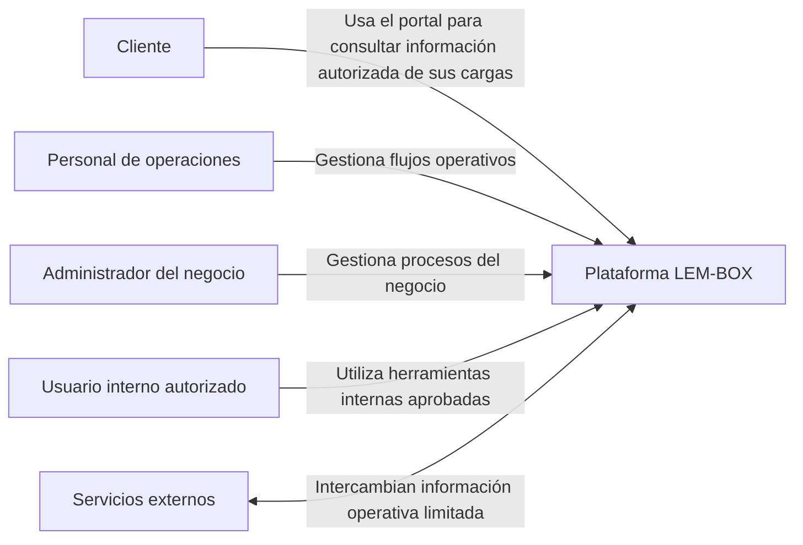
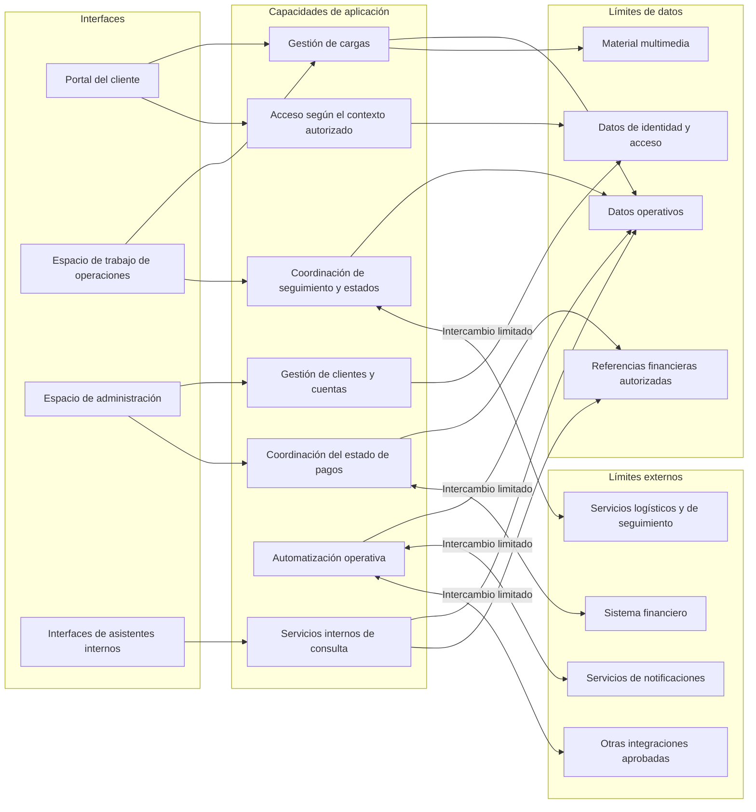
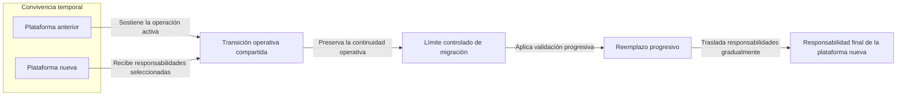

# Plataforma LEM-BOX — Arquitectura pública sanitizada

[English version](architecture.md)

> Este documento presenta una vista pública, sanitizada y no exhaustiva de la arquitectura. No es una topología de producción, una guía de despliegue, una especificación de seguridad ni un mapa completo de implementación.

## 1. Propósito y nivel de abstracción

Este documento explica la plataforma mediante grupos públicos de capacidades, límites lógicos y relaciones seleccionadas. Su objetivo es hacer comprensible el contexto del producto sin reproducir el sistema productivo privado.

Cada elemento fue generalizado deliberadamente. Un bloque representa una responsabilidad o un límite público, no necesariamente un componente desplegable, y una conexión representa una interacción conceptual, no un protocolo, un endpoint ni una ruta de datos.

## 2. Contexto del negocio y del producto

LEM-BOX sostiene una operación logística real entre Estados Unidos, Uruguay y Argentina. La plataforma reúne el contexto general necesario para trabajar con cargas, clientes, pagos, roles y trazabilidad.

El producto evoluciona dentro de una operación activa. Por eso su arquitectura debe comprenderse junto con el reemplazo progresivo de una plataforma anterior, que considera la continuidad operativa, la seguridad y la evolución sostenida como prioridades de la migración.

## 3. Contexto público del sistema

El siguiente diagrama identifica actores públicos generalizados y su relación de alto nivel con la plataforma. No representa roles productivos exactos, reglas de acceso, interfaces ni recorridos de integración.

Estas etiquetas describen únicamente categorías públicas de interacción. No exponen identidades de producción, nombres de roles, permisos ni proveedores de servicios.

## 4. Arquitectura lógica pública

Esta vista lógica organiza la plataforma en interfaces, capacidades de aplicación, límites de datos y límites externos. Es un modelo de comunicación, no un inventario de componentes ni un mapa de conectividad de producción.

Las flechas muestran únicamente que puede existir una relación de alto nivel. No definen direccionalidad en producción, propiedad, confianza, ubicación de red ni detalles de implementación.

## 5. Principales grupos de capacidades

La vista pública agrupa las responsabilidades de la plataforma de la siguiente manera:

- **Soporte del ciclo de una carga:** acompaña responsabilidades operativas seleccionadas asociadas con una carga sin publicar estados, transiciones ni reglas de negocio exactos.
- **Contexto de clientes y cuentas:** relaciona el contexto de clientes y cuentas con el trabajo operativo autorizado sin exponer registros ni modelos internos.
- **Acceso según el contexto autorizado:** adapta la información y las acciones disponibles al contexto autorizado de cada usuario sin describir roles, permisos ni lógica de aplicación exactos.
- **Visibilidad de seguimiento:** coordina el contexto público de seguimiento y estados sin documentar identificadores, comportamientos específicos de proveedores ni flujos completos.
- **Coordinación del estado de pagos:** incorpora el estado de pagos al contexto operativo general sin exponer la implementación de pagos, registros financieros ni lógica de precios.
- **Automatización operativa:** acompaña actividades operativas seleccionadas sin presentar scripts, disparadores, comportamiento de integraciones privadas ni decisiones totalmente automatizadas.
- **Asistentes internos:** facilitan que usuarios internos autorizados consulten contexto operativo o financiero permitido a nivel conceptual.
- **Material operativo:** asocia material multimedia con registros operativos relevantes sin describir almacenamiento, identificadores, retención ni reglas de acceso.

Estos grupos fueron seleccionados para una explicación pública y no representan un inventario exhaustivo del comportamiento de la plataforma.

## 6. Límites públicos de datos

La arquitectura utiliza categorías en lugar de modelos de datos:

- registros operativos;
- contexto de identidad y acceso;
- material multimedia asociado con registros operativos;
- información de estados y seguimiento; y
- referencias financieras autorizadas.

Estas categorías no revelan esquemas, nombres de campos, identificadores, reglas de retención, reglas completas de acceso ni datos de producción. El diagrama tampoco implica que cada categoría tenga un almacenamiento físico separado.

## 7. Límites de servicios externos

El modelo público reconoce categorías externas genéricas para logística y seguimiento, notificaciones, contexto financiero y otras integraciones aprobadas. Estos límites explican que la plataforma puede intercambiar información limitada con servicios externos; no revelan identidades de proveedores ni detalles de integraciones privadas.

Ninguna conexión de este documento especifica un protocolo, endpoint, ruta, credencial, contrato de datos, frecuencia, dirección de inicio ni límite de confianza de producción. El acceso externo permanece limitado por controles privados que están fuera de esta vista pública.

## 8. Modelo de migración progresiva

La plataforma reemplaza progresivamente una plataforma anterior en lugar de depender de una única sustitución inmediata. El modelo público muestra convivencia temporal, un límite controlado de migración, validación progresiva y un movimiento gradual de responsabilidades mientras la operación continúa.

Este diagrama no registra etapas internas de la migración. No incluye fechas, porcentajes, estrategias de sincronización, procedimientos de traslado de datos ni afirmaciones de que todas las responsabilidades siguen el mismo recorrido. Su propósito es mostrar cómo un cambio gradual puede reducir el riesgo de un reemplazo abrupto.

## 9. Asistentes internos a alto nivel

Los asistentes internos se presentan como interfaces aprobadas mediante las cuales un usuario interno autorizado puede consultar contexto operativo o financiero permitido. En este nivel de abstracción, una capacidad interna de consulta separa la interacción con el usuario de los límites de datos autorizados.

Los asistentes facilitan consultas; no sustituyen las autorizaciones ni los controles operativos, y este documento no los presenta como responsables de decisiones autónomas. Tampoco identifica un proveedor o modelo, revela prompts o consultas, muestra credenciales o datos, ni describe controles e implementación completos.

## 10. Contexto tecnológico

Esta arquitectura pública no incluye nombres de tecnologías del producto ni de su implementación. Una tecnología sólo podrá nombrarse en documentación futura cuando esté verificada en el producto, ya haya sido divulgada públicamente, no revele configuración y figure con evidencia de respaldo en el registro de afirmaciones públicas.

Hasta que se cumplan todas esas condiciones, las categorías genéricas —como interfaces, capacidades de aplicación, límites de datos y servicios externos— constituyen el nivel de descripción adecuado. Este documento no afirma el uso de ningún framework, proveedor de infraestructura, sistema de almacenamiento, protocolo ni versión en particular.

## 11. Detalles omitidos deliberadamente

Esta vista pública omite deliberadamente:

- la topología exacta de producción, el diseño de despliegue, la configuración y los límites de red;
- el código fuente, el historial Git de producción, los scripts administrativos y la lógica completa del negocio;
- los esquemas, colecciones, tablas, campos, identificadores, nombres de almacenamiento y reglas de retención;
- las APIs, endpoints, rutas, webhooks, contratos de datos, credenciales y valores de entorno;
- los roles, permisos, atributos de autorización, reglas de autorización y lógica de aplicación exactos;
- los nombres privados de servicios, proveedores, cuentas, proyectos y detalles de integraciones;
- los datos de producción, la información de clientes o empleados, los registros financieros, la implementación de pagos y la lógica de precios;
- los prompts internos, consultas, implementación de asistentes y comportamiento completo de las automatizaciones; y
- los hallazgos de seguridad, las vulnerabilidades actuales o históricas y los controles detallados de seguridad.

Estas exclusiones forman parte del límite de publicación; no representan documentación de despliegue pendiente.

## 12. Limitaciones de esta vista pública

La arquitectura está sanitizada, seleccionada y no es exhaustiva. Los elementos de los diagramas pueden reunir varias responsabilidades privadas o dividir un concepto público para facilitar su comprensión. Su ubicación y sus conexiones no permiten inferir componentes, topología, estructuras de datos, límites de seguridad ni procedimientos operativos de producción.

Este documento describe una abstracción pública profesional; no valida el sistema productivo, establece rendimiento o escala, afirma resultados de disponibilidad o seguridad, ni funciona como un plan de implementación. Las etiquetas y relaciones podrán ajustarse si material revisado posteriormente modifica la explicación útil que pueda ofrecerse de manera segura.

## 13. Gate de publicación y revisión

Esta arquitectura de la Fase 2 está incluida en el compañero técnico seleccionado como una abstracción sanitizada y no exhaustiva. No representa documentación de despliegue ni de producción.

Antes de cualquier actualización pública futura, cada afirmación, etiqueta, relación o diagrama que se agregue o modifique deberá mantenerse dentro del alcance público aprobado y superar revisión individual, sanitización, análisis de secretos, revisión de datos personales y aprobación independiente para publicación. Todo elemento que no pueda superar ese gate deberá generalizarse, posponerse u omitirse.
