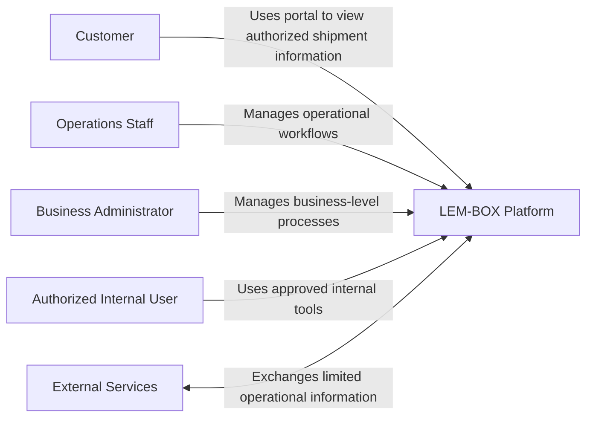
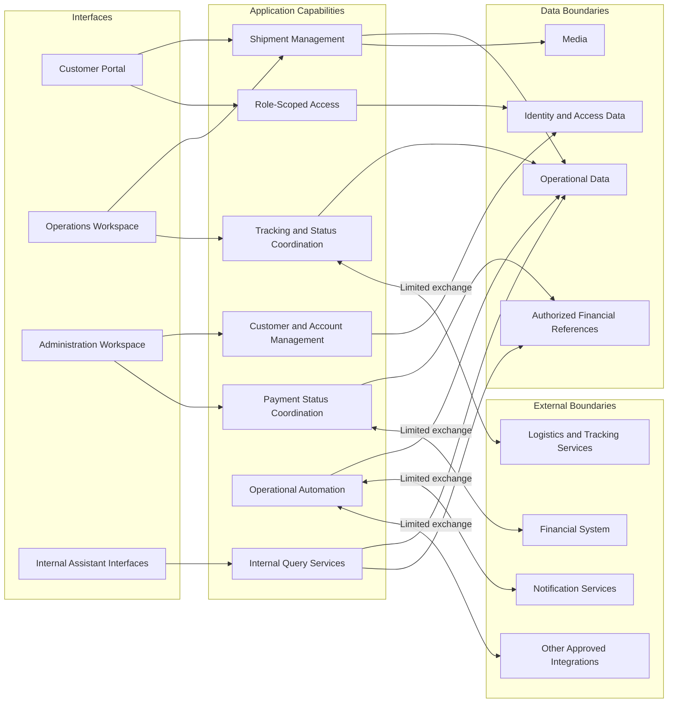
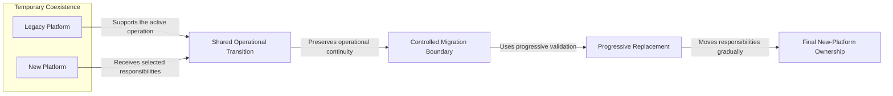

# LEM-BOX Platform — Sanitized Public Architecture

[Versión en español](architecture.es.md)

> This document presents a sanitized, non-exhaustive public architecture view. It is not a production topology, deployment guide, security specification, or complete implementation map.

## 1. Purpose and abstraction level

This document explains the platform through public capability groups, logical boundaries, and selected relationships. Its purpose is to make the product context understandable without reproducing the private system.

Every element is intentionally generalized. A box represents a public responsibility or boundary, not necessarily one deployable component, and a connection represents a conceptual interaction rather than a protocol, endpoint, or data path.

## 2. Business and product context

LEM-BOX supports a real logistics operation between the United States, Uruguay, and Argentina. The platform brings together the general context needed to work with shipments, customers, payments, roles, and traceability.

The product evolves within an active operation. Its architecture must therefore be understood alongside the progressive replacement of a legacy platform, with operational continuity, security, and continued evolution treated as migration priorities.

## 3. Public system context

The following diagram identifies generalized public actors and their high-level relationship with the platform. It does not represent exact production roles, access rules, interfaces, or integration paths.

These labels describe public interaction categories only. They do not expose production identities, role names, permissions, or service providers.

## 4. Public logical architecture

This logical view groups the platform into interfaces, application capabilities, data boundaries, and external boundaries. It is a communication model, not a component inventory or a map of production connectivity.

The arrows show only that a high-level relationship may exist. They do not define directionality in production, ownership, trust, network placement, or implementation detail.

## 5. Major capability groups

The public view groups platform responsibilities as follows:

- **Shipment lifecycle support:** supports selected operational responsibilities associated with a shipment without publishing exact states, transitions, or business rules.
- **Customer and account context:** relates customer and account context to authorized operational work without exposing records or internal models.
- **Role-scoped access:** adapts available information and actions to an authorized user context without describing exact roles, permissions, or enforcement logic.
- **Tracking visibility:** coordinates public tracking and status context without documenting identifiers, provider-specific behavior, or complete workflows.
- **Payment-status coordination:** makes payment status part of the broader operational context without exposing payment implementation, financial records, or pricing logic.
- **Operational automation:** supports selected operational activities without presenting scripts, triggers, private integration behavior, or fully automated decision-making.
- **Internal assistants:** help authorized internal users consult permitted operational or financial context at a conceptual level.
- **Operational media:** associates media with relevant operational records without describing storage, identifiers, retention, or access rules.

These groups are selected for public explanation and are not an exhaustive account of platform behavior.

## 6. Public data boundaries

The architecture uses categories rather than data models:

- operational records;
- identity and access context;
- media associated with operational records;
- status and tracking information; and
- authorized financial references.

These categories do not reveal schemas, field names, identifiers, retention rules, complete access rules, or production data. The diagram also does not imply that each category has a separate physical store.

## 7. External-service boundaries

The public model recognizes generic external categories for logistics and tracking, notifications, financial context, and other approved integrations. Those boundaries explain that the platform can exchange limited information with external services; they do not disclose provider identities or private integration details.

No connection in this document specifies a protocol, endpoint, route, credential, data contract, frequency, direction of initiation, or production trust boundary. External access remains limited by private controls that are outside this public view.

## 8. Progressive migration model

The platform progressively replaces a legacy platform rather than relying on one immediate substitution. The public model shows temporary coexistence, a controlled migration boundary, progressive validation, and a gradual movement of responsibilities while the operation continues.

This is not a record of internal migration stages. It includes no dates, percentages, synchronization strategy, data-movement procedure, or claim that every responsibility follows the same path. Its purpose is to show how gradual change can reduce the risk of an abrupt replacement.

## 9. Internal assistants at a high level

Internal assistants are presented as approved interfaces through which an authorized internal user can consult permitted operational or financial context. At this abstraction level, an internal query capability separates the user-facing interaction from authorized data boundaries.

The assistants facilitate queries; they do not replace authorization or operational controls, and this document does not present them as autonomous decision-makers. It does not identify a provider or model, reveal prompts or queries, show credentials or data, or describe complete controls and implementation.

## 10. Technology context

No product or implementation technology names are included in this public architecture. A technology may be named in future documentation only when it is verified in the product, has already been disclosed publicly, does not reveal configuration, and is recorded with supporting evidence in the public claims register.

Until all of those conditions are met, generic categories such as interfaces, application capabilities, data boundaries, and external services are the appropriate level of description. This document makes no claim about a particular framework, infrastructure provider, storage system, protocol, or version.

## 11. Deliberately omitted details

This public view deliberately omits:

- exact production topology, deployment design, configuration, and network boundaries;
- source code, production Git history, administrative scripts, and complete business logic;
- schemas, collections, tables, fields, identifiers, storage names, and retention rules;
- APIs, endpoints, routes, webhooks, data contracts, credentials, and environment values;
- exact roles, permissions, claims, authorization rules, and enforcement logic;
- private service names, providers, accounts, projects, and integration details;
- production data, customer or employee information, financial records, payment implementation, and pricing logic;
- internal prompts, queries, assistant implementation, and complete automation behavior; and
- security findings, current or historical vulnerabilities, and detailed security controls.

These omissions are part of the publication boundary, not missing deployment documentation.

## 12. Limitations of this public view

The architecture is sanitized, selected, and non-exhaustive. Diagram elements may combine several private responsibilities or divide one public concept for clarity. Their placement and connections cannot be used to infer production components, topology, data structures, security boundaries, or operational procedures.

This document describes a professional public abstraction; it does not validate the production system, establish performance or scale, make availability or security-outcome claims, or serve as an implementation plan. Labels and relationships may be refined when later reviewed material changes the safest useful explanation.

## 13. Publication and review gate

This Phase 2 architecture is included in the selected technical companion as a sanitized, non-exhaustive abstraction. It does not represent deployment or production documentation.

Before any future public update, each added or changed claim, label, relationship, and diagram must remain within the approved public scope and pass individual review, sanitization, secret scanning, personal-data review, and independent publication approval. Any element that cannot meet that gate must be generalized further, deferred, or omitted.
