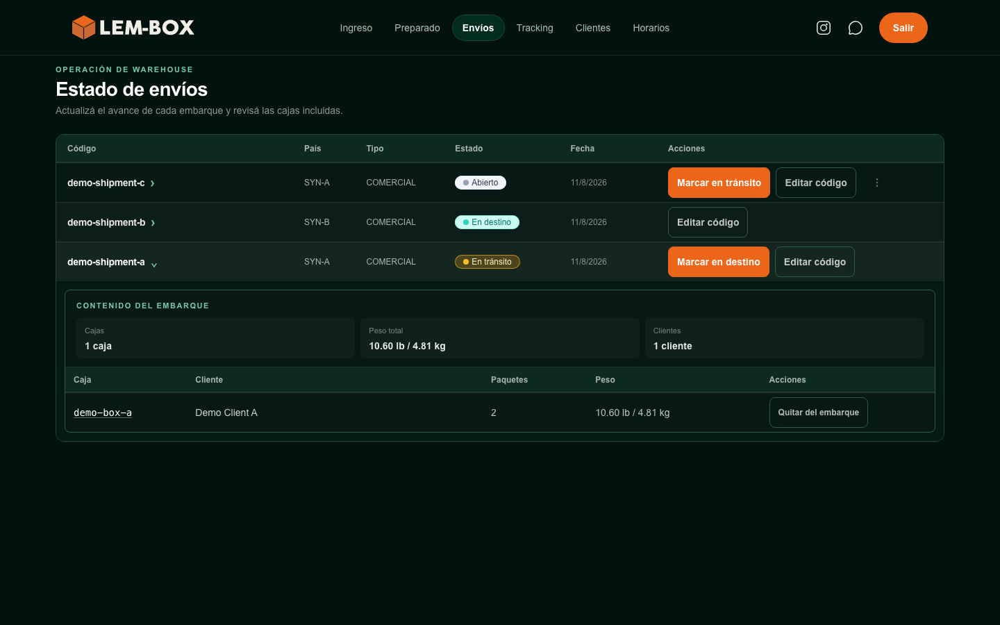
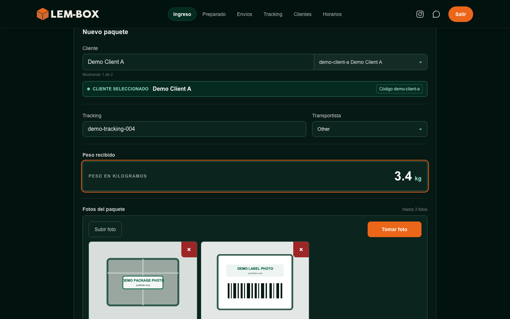
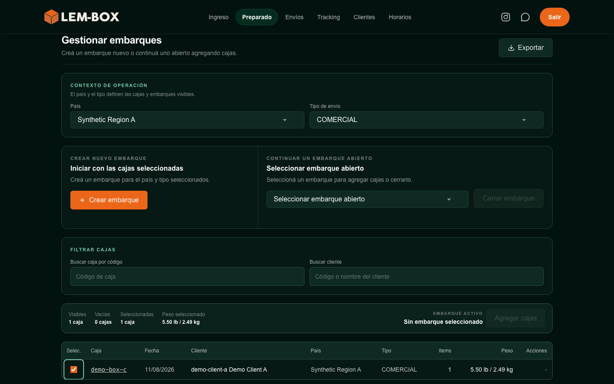
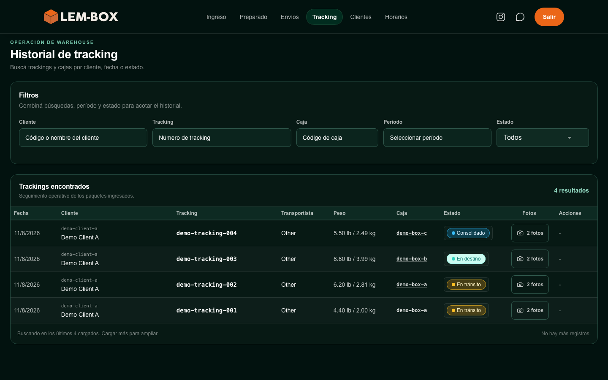
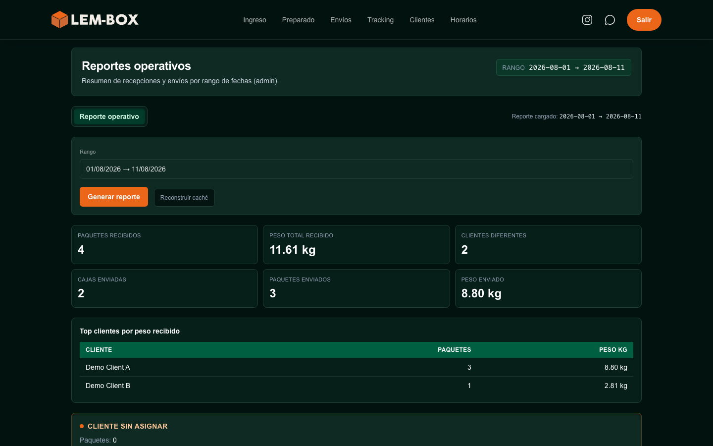
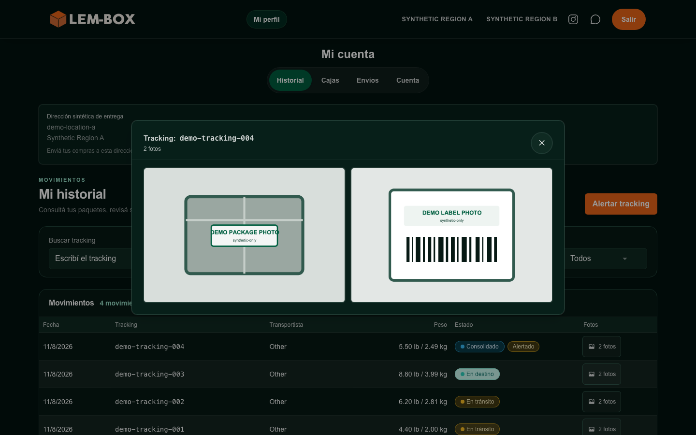
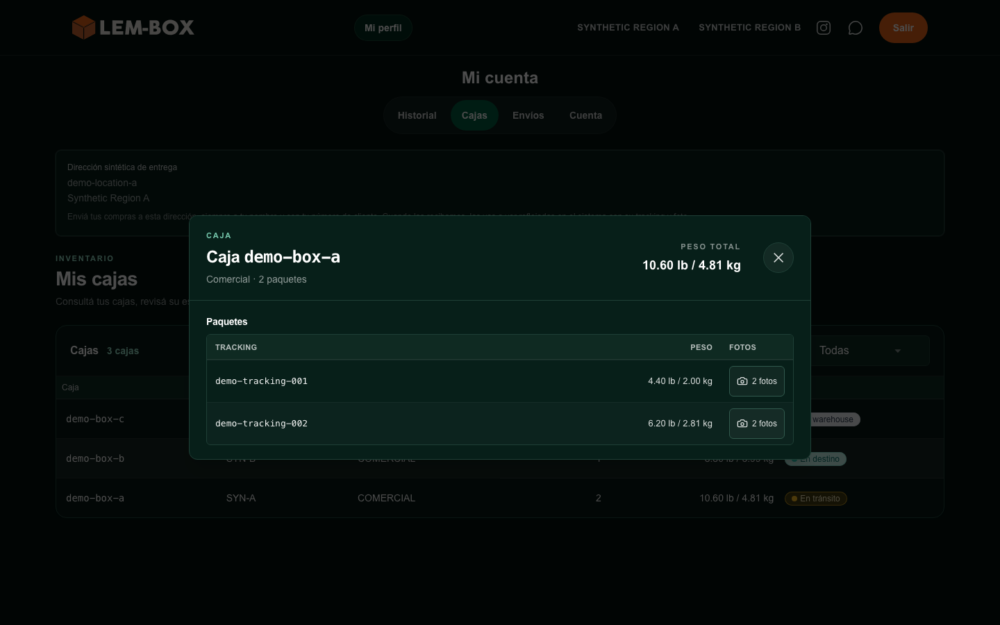
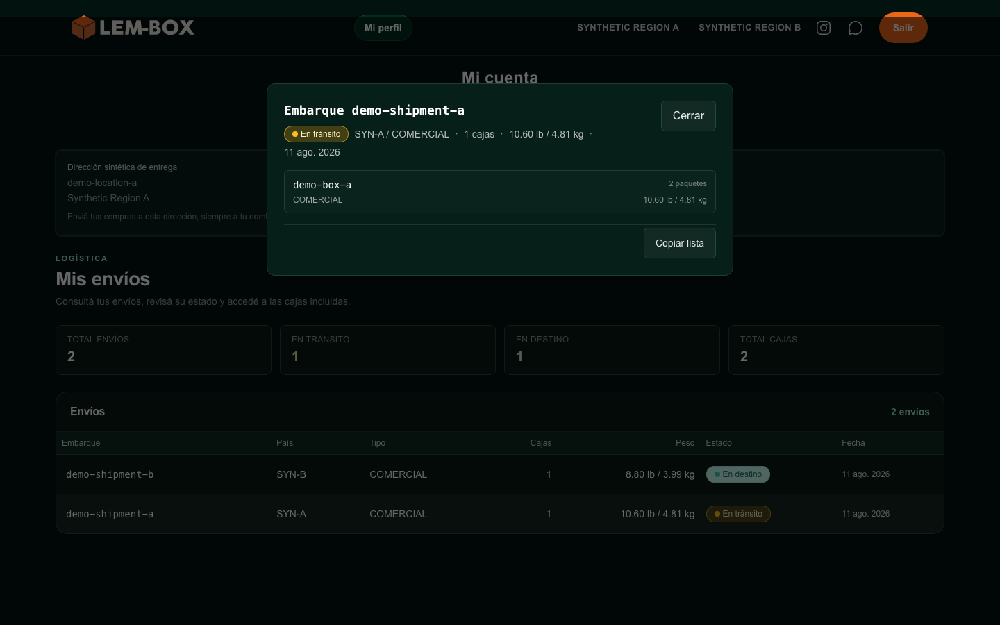
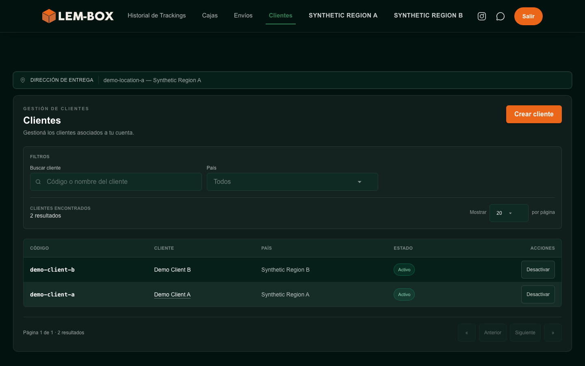

# Plataforma web LEM-BOX — Snapshot web actual v1

[English version](current-web-snapshot.md)

> Esta evidencia visual es un snapshot fechado del producto, no una afirmación de que la interfaz sea final o permanezca siempre vigente.

**Capturado:** agosto de 2026

## Propósito

Este snapshot ofrece evidencia revisable de nueve capacidades seleccionadas de la interfaz web real de LEM-BOX. Las superficies elegidas cubren trabajo administrativo y operativo, ingreso por operador, autoservicio de cliente, trabajo acotado de Partner y reportes operativos web. Todo el contenido a nivel de registro y todos los valores del negocio visibles fueron creados únicamente para esta sesión de captura.

## Fecha del snapshot

Current Web Snapshot v1 registra el estado verificable de la interfaz web seleccionada en agosto de 2026. LEM-BOX continúa evolucionando, por lo que los cambios posteriores no convierten este snapshot fechado en una afirmación de vigencia permanente.

## Qué muestran las imágenes

Las vistas seleccionadas ilustran:

- una vista general operativa de embarques;
- el ingreso de paquetes con cliente, tracking, peso y fotos locales ficticios;
- la preparación de embarques con una caja ficticia seleccionada;
- historial operativo, estados, búsqueda y trazabilidad;
- reportes operativos web con cantidades y distribuciones ficticias;
- historial de cliente con estados, pesos, controles de fotos y galería demo abierta;
- detalle de una caja de cliente con paquetes ficticios;
- resumen y detalle poblados de envíos del cliente; y
- un workspace de Partner limitado a clientes ficticios gestionados.

## Declaración sobre datos ficticios

Todas las identidades, registros, identificadores, fechas, cantidades, regiones, estados, pesos, conteos y valores operativos visibles son datos ficticios creados expresamente. Los identificadores de registros utilizan el namespace `demo-`, y las dos imágenes de paquetes son arte geométrico local de demostración. No se anonimizaron, transformaron, muestrearon ni exportaron datos de producción, ni se utilizaron para poblar estas capturas.

## Límites de captura y sanitización

Las imágenes se obtuvieron de la interfaz web real en una superficie de captura aislada de datos y autenticación productivos. La trazabilidad privada exacta de la fuente y del build se conserva únicamente en registros de auditoría no versionados. El código fuente productivo permanece privado e intacto.

Las sustituciones temporales se limitaron a autenticación, datos, media y servicios externos sintéticos, además de etiquetas visibles necesarias para mantener geografía operativa real fuera de los píxeles. No se difuminaron datos productivos, no se reconstruyó ni generó la interfaz mediante IA y no se modificaron el layout, el branding, la estructura de navegación ni el flujo funcional para su presentación.

## Galería de imágenes

### 1. Vista general de operaciones

La vista administrativa de estados de embarque muestra la navegación y la jerarquía actuales con regiones, identificadores, fechas y estados ficticios, además de un embarque sintético expandido.

**Límite de interpretación:** La imagen no establece volumen productivo, integridad, rendimiento ni resultados del negocio.

### 2. Ingreso operativo

La vista de ingreso por operador ilustra selección de cliente, tracking ficticio, transportista genérico, peso ficticio, estado visual de campos y fotos demo geométricas locales.

**Límite de interpretación:** La imagen no documenta el esquema productivo, todas las reglas de validación ni cada paso del ingreso.

### 3. Preparación de embarques

La vista de preparación muestra la organización real del contexto de embarque, las acciones para iniciar o continuar, los filtros, el resumen de selección y una caja ficticia elegible.

**Límite de interpretación:** La imagen no expone todas las reglas operativas internas ni comerciales.

### 4. Historial y trazabilidad

La vista de historial operativo ilustra filtros, búsqueda, estados, asociación con cajas, pesos, acceso a fotos y trazabilidad entre registros ficticios.

**Límite de interpretación:** La imagen no establece retención productiva, garantías de auditoría ni cobertura completa del ciclo de vida.

### 5. Reportes operativos web

La vista de reportes ilustra un período ficticio, totales operativos sintéticos y una distribución entre clientes demo dentro de la interfaz web real. No se muestra ninguna superficie de mensajería ni de asistente interno.

**Límite de interpretación:** Todas las cantidades, períodos, distribuciones, pesos y estados son ficticios; la imagen no muestra métricas productivas ni resultados del negocio.

### 6. Historial y fotos del cliente

La vista de historial del cliente muestra varias filas ficticias y una galería abierta con las imágenes locales `DEMO PACKAGE PHOTO` y `DEMO LABEL PHOTO` dentro del mismo contexto de cuenta sintética.

**Límite de interpretación:** La imagen no divulga ni demuestra el modelo completo de autorización o seguridad.

### 7. Detalle de caja del cliente

La vista de cajas del cliente muestra inventario sintético poblado y el detalle abierto de una caja ficticia con trazabilidad por paquete y acceso a fotos.

**Límite de interpretación:** La imagen no establece inventario productivo, reglas de consolidación ni garantías de ciclo de vida.

### 8. Envíos del cliente

La vista de envíos del cliente muestra un resumen sintético no vacío, varios estados y regiones ficticios, cajas asociadas y la acción estable de detalle.

**Límite de interpretación:** La imagen no representa volumen, tiempos, rutas ni resultados productivos del servicio.

### 9. Workspace de Partner

El workspace de clientes de Partner fue elegido porque demuestra con claridad navegación diferenciada, contexto operativo acotado y clientes demo gestionados sin exponer reglas internas de autorización.

**Límite de interpretación:** La imagen no divulga reglas tenant, claims, implementación interna de roles ni el modelo completo de autorización.

## Qué se excluye intencionalmente

Este snapshot excluye pantallas autenticadas y datos de producción, roles exactos y reglas de permisos, URLs privadas y detalles del build, información financiera, integraciones privadas, detalles de despliegue, Telegram, mensajería, bots, conversaciones, prompts, modelos, proveedores, asistentes internos e interfaces móviles.

## Limitaciones

Estas vistas estáticas y seleccionadas no demuestran seguridad completa, rendimiento, escalabilidad, disponibilidad, arquitectura, comportamiento de autorización, escala productiva ni resultados del negocio. Los registros ficticios no representan valores, volúmenes, distribuciones ni casos límite de producción.

## Política de actualización

Esta versión conserva utilidad como evidencia histórica fechada. La atestación dirigida de la Fase 4B asociada con esta versión no encontró cambios materiales posteriores al baseline en las capturas 06 o 09, por lo que no fue necesario un refresh selectivo. Antes de cualquier actualización pública futura, los cambios materiales de navegación, identidad visual, flujo, alcance, capacidad visible, acción principal, estructura de datos presentada o experiencia según contexto de usuario exigen una nueva evaluación dirigida y, cuando corresponda, un refresh selectivo revisado o un snapshot nuevo.

## Evidencia móvil futura

La evidencia móvil permanece como una actualización futura separada y no está implícita en este snapshot web. La Fase 4A2 también permanece como trabajo futuro separado y no ha comenzado; este snapshot no contiene evidencia de Telegram, mensajería, bots, conversaciones ni asistentes internos.

## Gate de revisión y publicación

La Fase 4A completó sus gates de revisión independiente, aprobación del propietario y aceptación de la versión exacta, y el snapshot de nueve imágenes está incluido como evidencia fechada. La atestación dirigida de la Fase 4B para esta versión no encontró cambios materiales posteriores al baseline en las dos vistas candidatas condicionales. Estos registros no convierten el snapshot en una demo pública ni autorizan por sí solos la publicación del repositorio.
