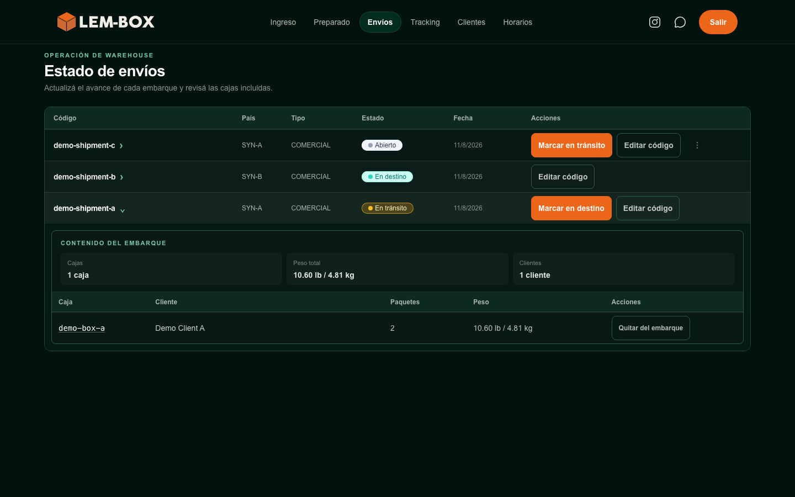
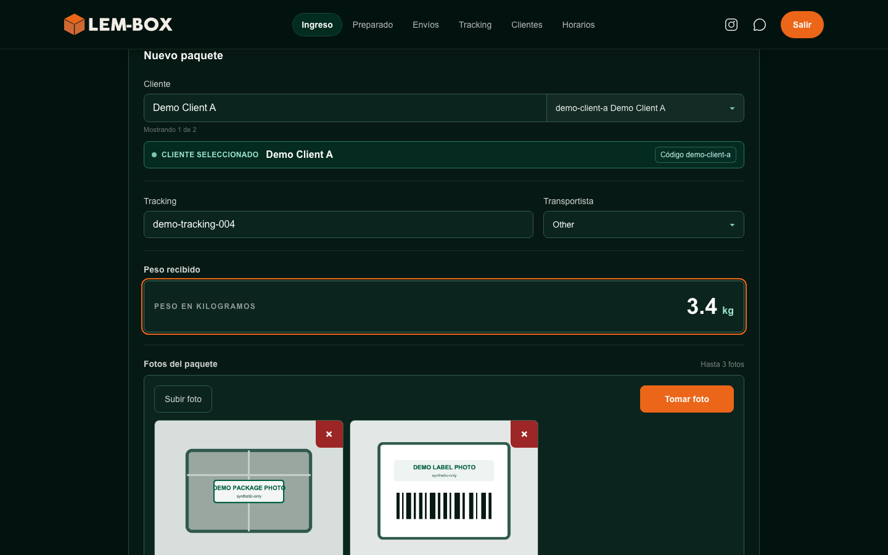
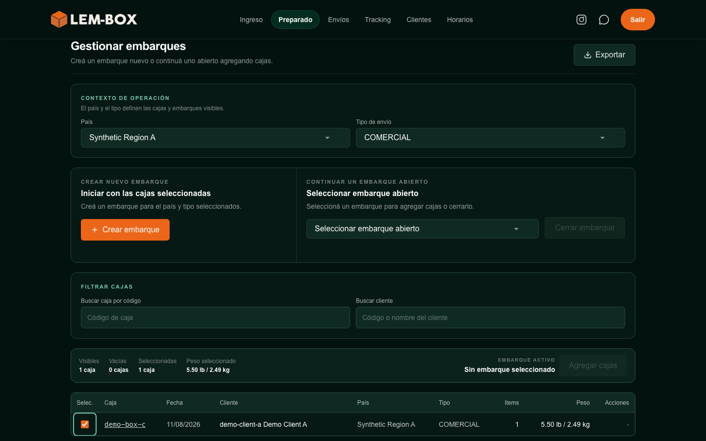
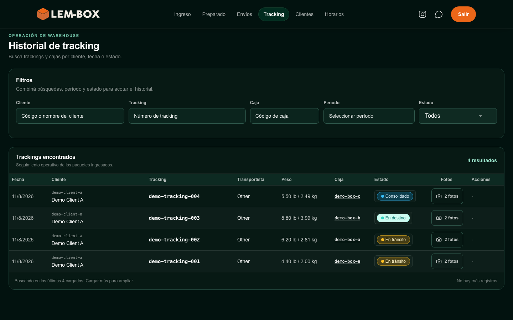
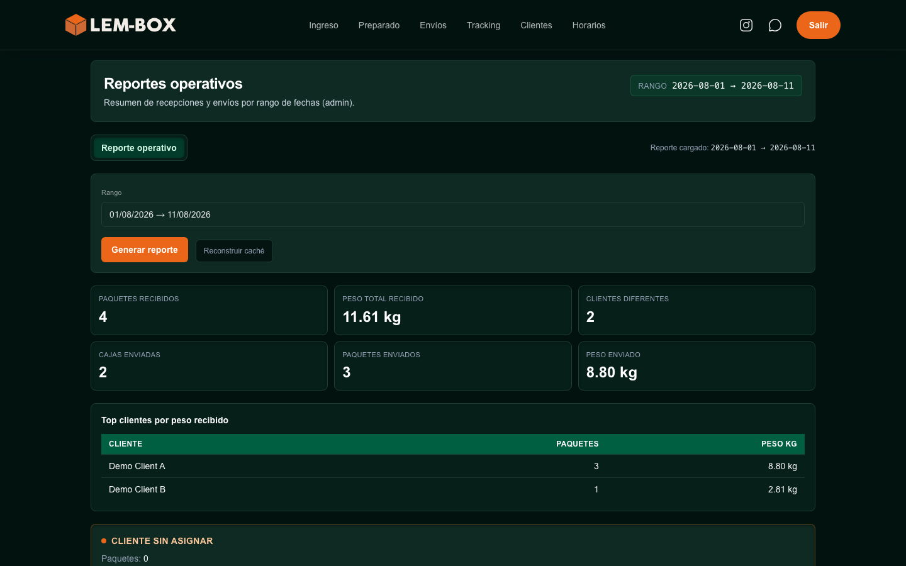
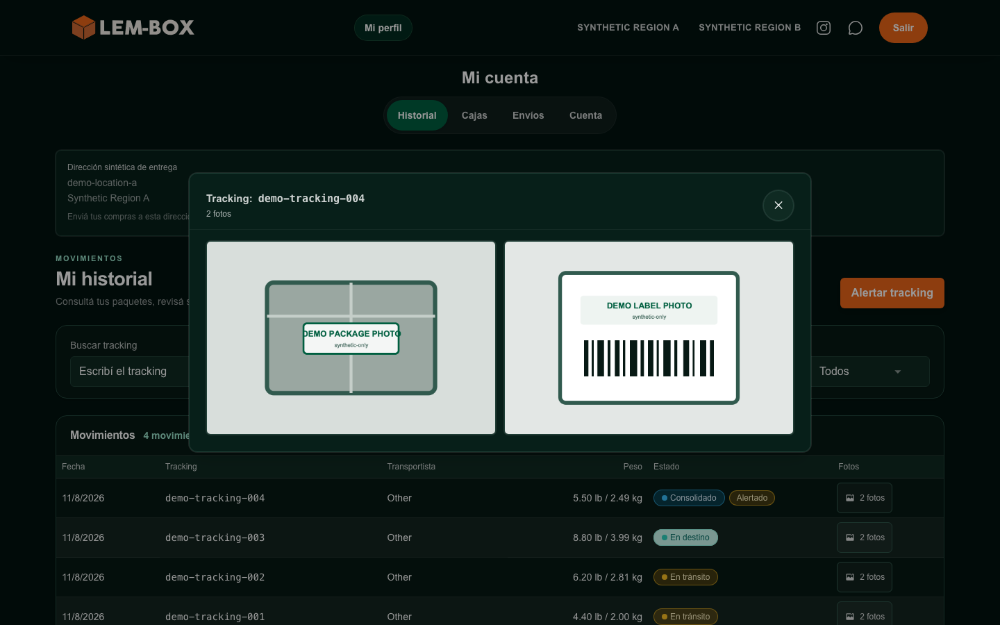
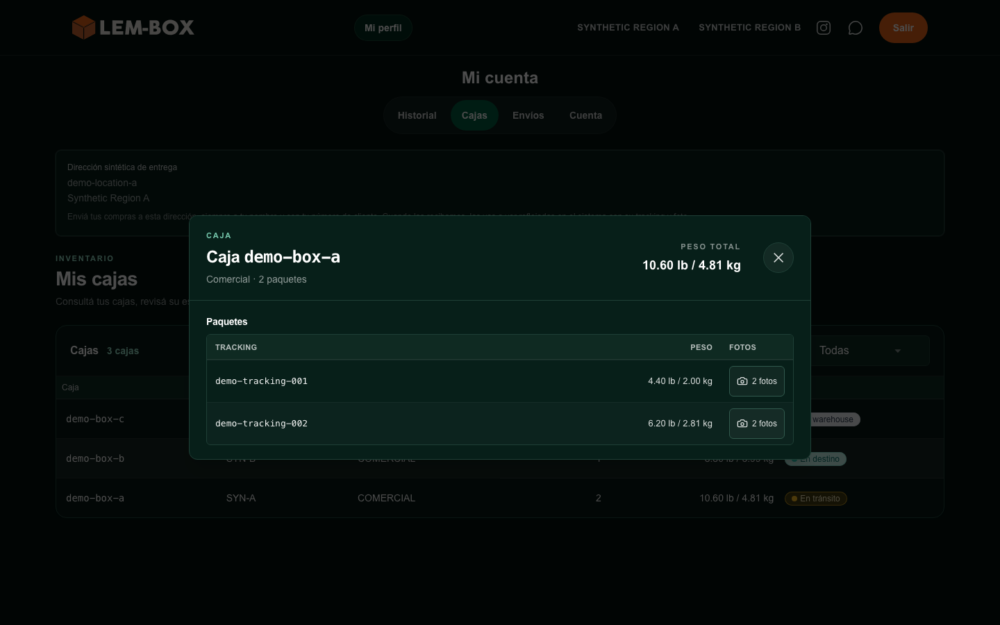
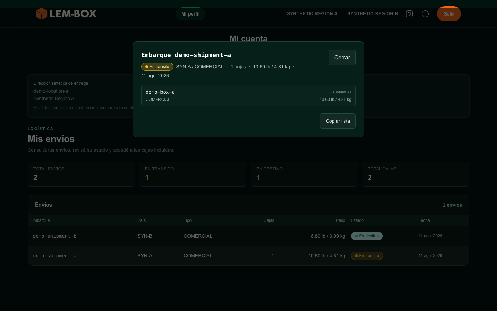
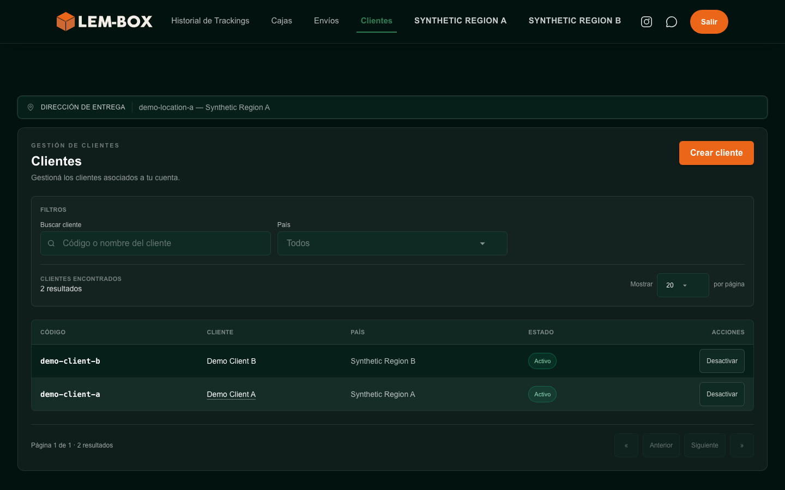

# LEM-BOX Web Platform — Current Web Snapshot v1

[Spanish version](current-web-snapshot.es.md)

> This visual evidence is a dated product snapshot, not a claim that the interface is final or permanently current.

**Captured:** August 2026

## Purpose

This snapshot provides reviewable evidence of nine selected capabilities in the real LEM-BOX web interface. The selected surfaces cover administrative and operations work, operator intake, customer self-service, partner-scoped work, and web operational reporting. All record-level content and business values shown were created solely for this capture session.

## Snapshot date

Current Web Snapshot v1 records the verifiable state of the selected web interface in August 2026. LEM-BOX continues to evolve, so later interface changes do not turn this dated snapshot into a claim of permanent currency.

## What the images demonstrate

The selected views illustrate:

- an operational shipment overview;
- package intake with a synthetic customer, tracking, weight, and local demo photos;
- shipment preparation with a selected synthetic box;
- searchable operational history, states, and traceability;
- web operational reporting with fictional counts and distributions;
- customer history with visible states, weights, photo controls, and an open demo-photo gallery;
- customer box detail with synthetic package records;
- a populated customer shipment summary and detail; and
- a partner workspace limited to managed synthetic customers.

## Synthetic-data statement

All displayed identities, records, identifiers, dates, quantities, regions, states, weights, counts, and operational values are purpose-built synthetic data. Record identifiers use the `demo-` namespace, and the two package images use local geometric demo artwork. No production data was anonymized, transformed, sampled, exported, or used to populate these captures.

## Capture and sanitization boundaries

The images were captured from the real web interface on a capture surface isolated from production data and authentication. Exact private source and build traceability is retained only in non-versioned audit records. The production source remains private and unchanged.

Temporary substitutions were limited to synthetic authentication, data, media, external-service boundaries, and display labels required to keep real operational geography out of the pixels. No production data was blurred, no interface was reconstructed or generated with AI, and no layout, branding, navigation structure, or functional workflow was changed for presentation.

## Image gallery

### 1. Operations Overview

The administrative shipment-status view shows the current navigation and hierarchy with fictional regions, identifiers, dates, states, and an expanded synthetic shipment.

**Interpretation limit:** This image does not establish production volume, completeness, performance, or business outcomes.

### 2. Operational Intake

The operator intake view illustrates customer selection, a fictional tracking identifier, a generic carrier selection, a fictional weight, visual field state, and local geometric demo photos.

**Interpretation limit:** This image does not document the production schema, complete validation rules, or every intake step.

### 3. Shipment Preparation

The preparation view shows the real organization for shipment context, new or continuing shipment actions, filters, selection summary, and an eligible synthetic box.

**Interpretation limit:** This image does not expose complete internal operating or commercial rules.

### 4. History and Traceability

The operational history view illustrates filtering, search, states, box association, weights, photo access, and traceability across fictional records.

**Interpretation limit:** This image does not establish production retention, audit guarantees, or complete lifecycle coverage.

### 5. Web Operational Reporting

The reporting view illustrates a fictional reporting period, synthetic operational totals, and a demo-customer distribution inside the real web interface. No messaging or internal-assistant surface is shown.

**Interpretation limit:** All counts, periods, distributions, weights, and states are fictional; this image does not show production metrics or business results.

### 6. Customer History and Photos

The customer history view shows several fictional package rows and an open gallery containing the local `DEMO PACKAGE PHOTO` and `DEMO LABEL PHOTO` images for the same synthetic account context.

**Interpretation limit:** This image does not disclose or prove the complete authorization or security model.

### 7. Customer Box Detail

The customer box view shows a populated synthetic inventory and an open detail for one fictional box with package-level traceability and photo access.

**Interpretation limit:** This image does not establish production inventory, consolidation rules, or lifecycle guarantees.

### 8. Customer Shipments

The customer shipment view shows a non-empty synthetic summary, several fictional states and regions, associated boxes, and the stable detail action.

**Interpretation limit:** This image does not represent production shipment volume, timing, routing, or service outcomes.

### 9. Partner Workspace

The partner customer workspace was selected because it clearly demonstrates differentiated navigation, partner-scoped operational context, and managed demo customers without exposing internal authorization rules.

**Interpretation limit:** This image does not disclose tenant rules, claims, internal role implementation, or the complete authorization model.

## What is intentionally not shown

This snapshot excludes production-authenticated screens and data, exact roles and permission rules, private URLs and build details, financial information, private integrations, deployment details, Telegram, messaging, bots, conversations, prompts, models, providers, internal-assistant surfaces, and mobile interfaces.

## Limitations

These static, selected views do not demonstrate complete security, performance, scalability, availability, architecture, authorization behavior, production scale, or business outcomes. Synthetic records do not represent production values, volumes, distributions, or edge cases.

## Refresh policy

This version remains useful as dated historical evidence. The targeted Phase 4B attestation associated with this version found no material post-baseline change affecting captures 06 or 09, so no selective refresh was required. Before any future public update, material changes to navigation, visual identity, workflow, scope, visible capability, primary action, presented data structure, or user-context experience require a new targeted assessment and, when necessary, a reviewed selective refresh or new snapshot.

## Future mobile evidence

Mobile evidence remains a separate future update and is not implied by this web snapshot. Phase 4A2 also remains separate future work and has not started; this snapshot contains no Telegram, messaging, bot, conversation, or internal-assistant evidence.

## Review and publication gate

Phase 4A completed its independent, owner-approval, and exact-version acceptance gates, and the nine-image snapshot is included as dated evidence. The targeted Phase 4B attestation for this version found no material post-baseline change in the two conditional candidate views. These records do not turn the snapshot into a public demo or authorize repository publication by themselves.
