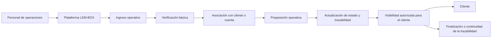
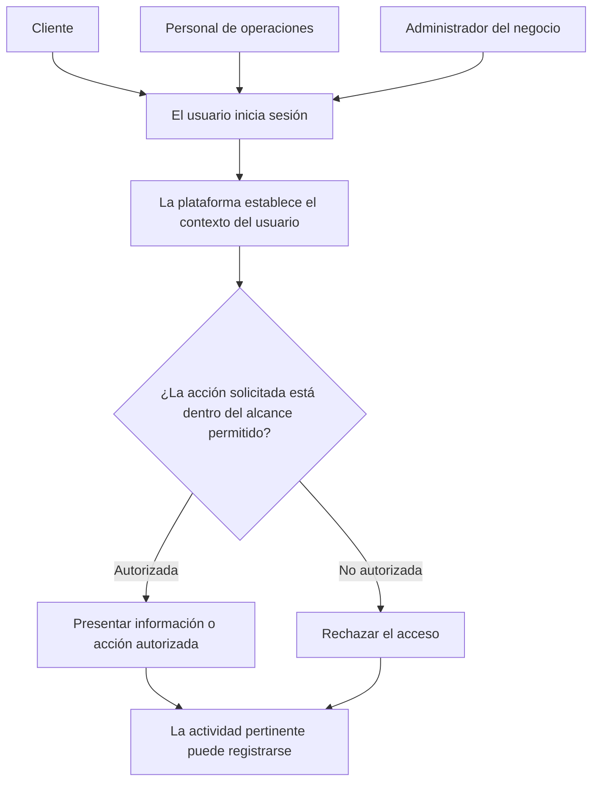
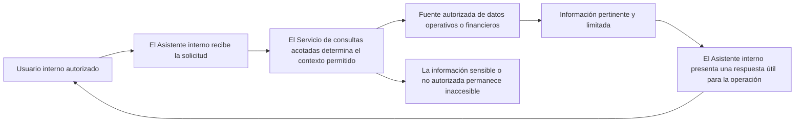

# Plataforma LEM-BOX — Flujos públicos seleccionados

[English version](selected-workflows.md)

> Los flujos de este documento son modelos públicos simplificados. Los actores, estados, puntos de decisión y nombres fueron generalizados deliberadamente y no reproducen la implementación completa de producción.

El sistema productivo permanece privado. Estos flujos explican conceptos seleccionados de producto y operación sin divulgar datos productivos, reglas exactas, detalles de implementación ni información de despliegue.

## 1. Del ingreso operativo a la visibilidad del cliente

### Propósito

Mostrar conceptualmente cómo una carga pasa desde el ingreso operativo hasta un punto en el que un cliente autorizado puede consultar su estado general.

### Actores

- Personal de operaciones.
- Plataforma LEM-BOX.
- Cliente.

### Secuencia simplificada

1. **Ingreso operativo.** El Personal de operaciones inicia el contexto operativo en la plataforma.
2. **Verificación básica.** La plataforma facilita una comprobación general antes de que el flujo continúe.
3. **Asociación con cliente o cuenta.** El contexto operativo se asocia con el contexto correspondiente de un cliente o una cuenta autorizados.
4. **Preparación operativa.** El Personal de operaciones hace avanzar la carga mediante una etapa generalizada de preparación.
5. **Actualización de estado y trazabilidad.** La plataforma refleja una actualización pertinente y de alto nivel sobre el estado y la trazabilidad.
6. **Visibilidad autorizada para el cliente.** El cliente puede consultar únicamente la información disponible dentro de su contexto autorizado.
7. **Finalización o continuidad de la trazabilidad.** El flujo alcanza un punto generalizado de finalización o continúa recibiendo actualizaciones de trazabilidad.

### Diagrama Mermaid sanitizado

### Qué demuestra el modelo

- Una progresión acotada desde el ingreso operativo hasta la visibilidad para el cliente.
- El apoyo de la plataforma para coordinar un contexto operativo y de trazabilidad generalizado.
- Una visibilidad para el cliente que depende de un contexto autorizado.

### Qué omite intencionalmente el modelo

- Estados productivos exactos y sus transiciones.
- Procesos de impresión de etiquetas, identificadores, nombres de campos, pesos y tarifas.
- Lógica de lotes, reglas internas y validaciones exactas.
- Estructuras de datos productivas, detalles de implementación y excepciones operativas.

### Limitaciones públicas

- La secuencia es una abstracción pública, no un flujo operativo completo ni un manual de operación.
- Su orden no define el modelo de eventos ni el proceso exacto de tratamiento en producción.
- No es una especificación de datos, seguridad, integraciones o despliegue.

## 2. Acceso según el contexto autorizado

### Propósito

Mostrar que la plataforma adapta la información y las acciones disponibles al contexto autorizado de cada usuario.

> Este modelo no es una especificación de autorización de producción y no revela nombres exactos de roles, atributos de autorización, reglas, permisos ni lógica de aplicación.

### Actores

- Cliente.
- Personal de operaciones.
- Administrador del negocio.
- Plataforma.

### Secuencia simplificada

1. **El usuario inicia sesión.** Un usuario comienza una interacción autenticada con la plataforma.
2. **La plataforma establece el contexto del usuario.** La plataforma identifica el contexto general necesario para evaluar la interacción.
3. **La acción solicitada se evalúa frente al alcance permitido.** La plataforma determina si la solicitud se encuentra dentro de ese contexto.
4. **Se presenta la información o acción autorizada.** Una solicitud permitida puede continuar dentro de su alcance aprobado.
5. **Se rechaza el acceso no autorizado.** Una solicitud fuera del alcance permitido no queda disponible.
6. **La actividad pertinente puede registrarse.** La plataforma puede conservar un registro apropiado de actividad sin que este modelo defina cómo.

### Diagrama Mermaid sanitizado

### Qué demuestra el modelo

- Una plataforma compartida puede presentar información y acciones diferentes según el contexto autorizado del usuario.
- El acceso se evalúa antes de que la información o las acciones solicitadas queden disponibles.
- Las solicitudes fuera del alcance permitido se rechazan y la actividad pertinente puede registrarse.

### Qué omite intencionalmente el modelo

- Nombres exactos de roles productivos, atributos de autorización y estructuras internas de usuario.
- Permisos específicos, separación de contextos, rutas y reglas de bases de datos.
- Comportamientos alternativos, lógica detallada de aplicación e implementación de controles.
- Configuración de autenticación, identificadores y procedimientos administrativos.

### Limitaciones públicas

- El modelo no es un diseño completo de identidad, autenticación o autorización.
- No establece el modelo de seguridad productivo ni revela cómo se implementan los controles.
- Los actores públicos están generalizados y no deben interpretarse como roles productivos exactos.

## 3. Consulta mediante asistente interno

### Propósito

Mostrar conceptualmente cómo un usuario interno autorizado formula una pregunta operativa o financiera y recibe una respuesta limitada a partir de un contexto de datos aprobado.

> Este es un flujo conceptual de asistencia a consultas, no una afirmación de producto de IA. No se describe el proveedor ni el modelo; no se muestran prompts, consultas, credenciales ni datos; y no se detallan controles. Tampoco se afirma una automatización total de decisiones. La herramienta facilita consultas; no sustituye autorizaciones ni controles operativos.

### Actores

- Usuario interno autorizado.
- Asistente interno.
- Servicio de consultas acotadas.
- Fuente autorizada de datos operativos o financieros.

### Secuencia simplificada

1. **El usuario autorizado formula una pregunta de negocio.** La interacción comienza dentro de un contexto interno aprobado.
2. **El asistente recibe la solicitud.** El Asistente interno acepta la pregunta para su tratamiento acotado.
3. **El servicio de consultas acotadas determina el contexto de datos permitido.** La solicitud se limita a un alcance autorizado antes de pedir información.
4. **La fuente aprobada devuelve información pertinente y limitada.** La fuente autorizada pone a disposición del flujo únicamente información pertinente y permitida.
5. **El asistente presenta una respuesta útil para la operación.** El Asistente interno devuelve una respuesta acotada al usuario autorizado.
6. **La información sensible o no autorizada permanece inaccesible.** La información fuera del contexto permitido no se expone mediante el flujo.

### Diagrama Mermaid sanitizado

### Qué demuestra el modelo

- Un usuario interno autorizado puede solicitar información útil para la operación mediante una interfaz acotada.
- Un servicio de alcance limitado media el acceso a un contexto aprobado de datos operativos o financieros.
- La respuesta se limita a información pertinente y permitida, mientras que la información no autorizada permanece inaccesible.

### Qué omite intencionalmente el modelo

- Proveedor, modelo, implementación y detalles de integración.
- Prompts, instrucciones internas, consultas exactas y ejemplos de respuestas.
- Credenciales, configuración, registros de origen, valores y detalles financieros.
- Controles detallados, permisos, lógica de autorización y lógica de decisiones automatizadas.

### Limitaciones públicas

- Este modelo no es una afirmación de producto de IA ni presenta afirmaciones sobre IA, aprendizaje automático, exactitud, rendimiento o exhaustividad.
- No describe ni valida la implementación productiva del asistente ni sus controles.
- El asistente facilita consultas autorizadas; no toma decisiones totalmente automatizadas ni sustituye autorizaciones y controles operativos.
