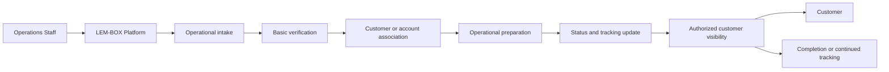
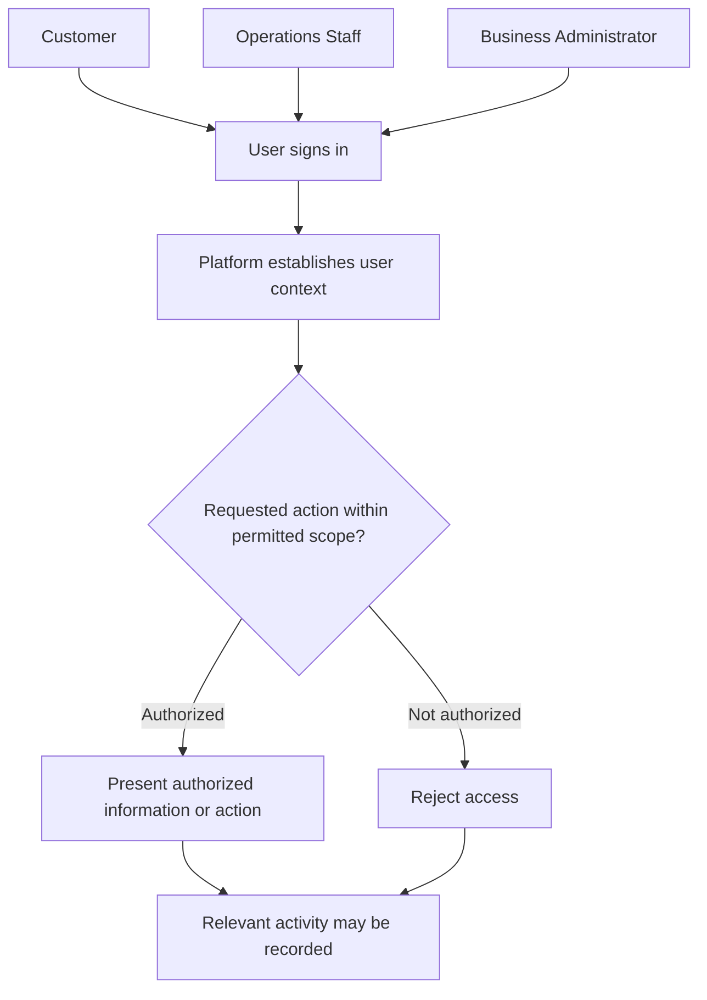
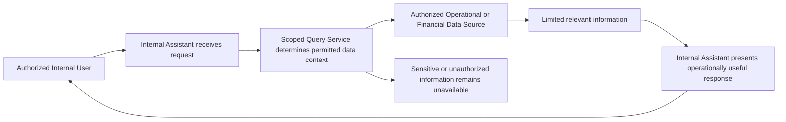

# LEM-BOX Platform — Selected Public Workflows

[Spanish version](selected-workflows.es.md)

> The workflows in this document are simplified public models. Actors, states, decision points, and labels are intentionally generalized and do not reproduce the complete production implementation.

Production remains private. These workflows explain selected product and operational concepts without disclosing production data, exact rules, implementation details, or deployment information.

## 1. Operational intake to customer visibility

### Purpose

Show conceptually how a shipment moves from operational intake to a point where an authorized customer can view its generalized status.

### Actors

- Operations Staff.
- LEM-BOX Platform.
- Customer.

### Simplified sequence

1. **Operational intake.** Operations Staff initiates the operational context in the platform.
2. **Basic verification.** The platform supports a general check before the workflow continues.
3. **Customer or account association.** The operational context is associated with the relevant authorized customer or account context.
4. **Operational preparation.** Operations Staff advances the shipment through a generalized preparation step.
5. **Status and tracking update.** The platform reflects an appropriate high-level status and tracking update.
6. **Authorized customer visibility.** The customer can view only the information available within the authorized context.
7. **Completion or continued tracking.** The workflow either reaches a generalized completion point or continues to receive tracking updates.

### Sanitized Mermaid diagram

### What the model demonstrates

- A bounded progression from operational intake to customer-facing visibility.
- Platform support for coordinating generalized operational and tracking context.
- Customer visibility that depends on an authorized context.

### What the model intentionally omits

- Exact production states and state transitions.
- Label-printing processes, identifiers, field names, weights, and rates.
- Batch logic, internal rules, and exact validations.
- Production data structures, implementation details, and operational exceptions.

### Public limitations

- The sequence is a public abstraction, not a complete operational workflow or runbook.
- Its ordering does not define the production event model or exact handling process.
- It is not a data, security, integration, or deployment specification.

## 2. Role-scoped access

### Purpose

Show that the platform adapts information and available actions to the authorized context of each user.

> This is not a production authorization specification and does not disclose exact roles, claims, rules, permissions, or enforcement logic.

### Actors

- Customer.
- Operations Staff.
- Business Administrator.
- Platform.

### Simplified sequence

1. **User signs in.** A user begins an authenticated interaction with the platform.
2. **Platform establishes user context.** The platform identifies the generalized context needed to evaluate the interaction.
3. **Requested action is evaluated against permitted scope.** The platform determines whether the request is within that context.
4. **Authorized information or action is presented.** A permitted request can proceed within its approved scope.
5. **Unauthorized access is rejected.** A request outside the permitted scope is not made available.
6. **Relevant activity may be recorded.** The platform may retain an appropriate activity record without this model defining how.

### Sanitized Mermaid diagram

### What the model demonstrates

- A shared platform can present different information and actions according to authorized user context.
- Access is evaluated before requested information or actions are made available.
- Requests outside the permitted scope are rejected, and relevant activity may be recorded.

### What the model intentionally omits

- Exact production role names, claims, and user-document structures.
- Specific permissions, tenant logic, routes, and database rules.
- Fallback behavior, detailed enforcement logic, and control implementation.
- Authentication configuration, identifiers, and administrative procedures.

### Public limitations

- The model is not a complete identity, authentication, or authorization design.
- It does not establish the production security model or disclose how controls are implemented.
- The public actors are generalized and must not be interpreted as exact production roles.

## 3. Internal assistant query

### Purpose

Show conceptually how an authorized internal user submits an operational or financial business question and receives a limited response from an approved data context.

> This is a conceptual query-assistance workflow, not an AI-product claim. It does not describe a provider or model; show prompts, queries, credentials, or data; or detail controls. It makes no claim of fully automated decision-making. The tool facilitates queries; it does not replace authorization or operational controls.

### Actors

- Authorized Internal User.
- Internal Assistant.
- Scoped Query Service.
- Authorized Operational or Financial Data Source.

### Simplified sequence

1. **Authorized user submits a business question.** The interaction begins within an approved internal context.
2. **Assistant receives the request.** The Internal Assistant accepts the question for scoped handling.
3. **Scoped query service determines the permitted data context.** The request is constrained to an authorized scope before information is requested.
4. **Approved source returns limited relevant information.** The authorized source makes only relevant, permitted information available to the workflow.
5. **Assistant presents an operationally useful response.** The Internal Assistant returns a bounded response to the authorized user.
6. **Sensitive or unauthorized information remains unavailable.** Information outside the permitted context is not exposed through the workflow.

### Sanitized Mermaid diagram

### What the model demonstrates

- An authorized internal user can request operationally useful information through a bounded interface.
- A scoped service mediates access to an approved operational or financial data context.
- The response is limited to relevant, permitted information while unauthorized information remains unavailable.

### What the model intentionally omits

- Provider, model, implementation, and integration details.
- Prompts, internal instructions, exact queries, and response examples.
- Credentials, configuration, source records, values, and financial details.
- Detailed controls, permissions, authorization logic, and automated decision logic.

### Public limitations

- This model is not an AI-product claim and makes no AI, machine-learning, accuracy, performance, or completeness claim.
- It does not describe or validate the production assistant implementation or its controls.
- The assistant facilitates authorized queries; it does not make fully automated decisions or replace authorization and operational controls.
